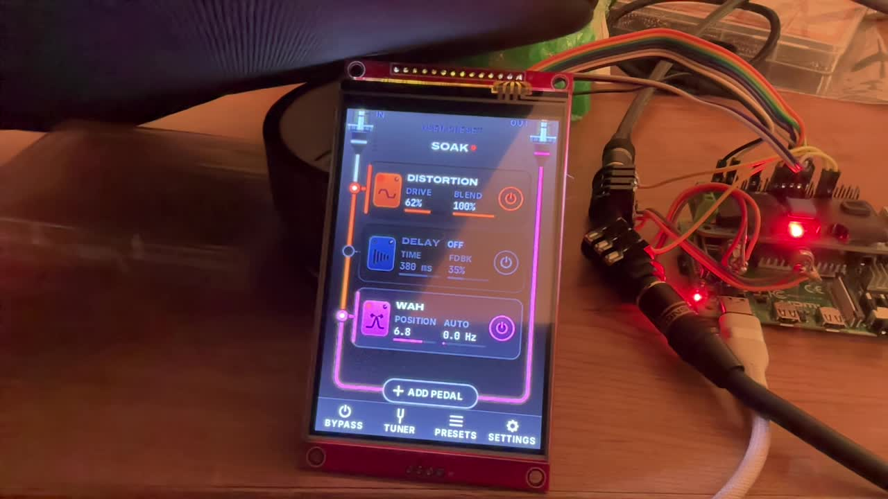
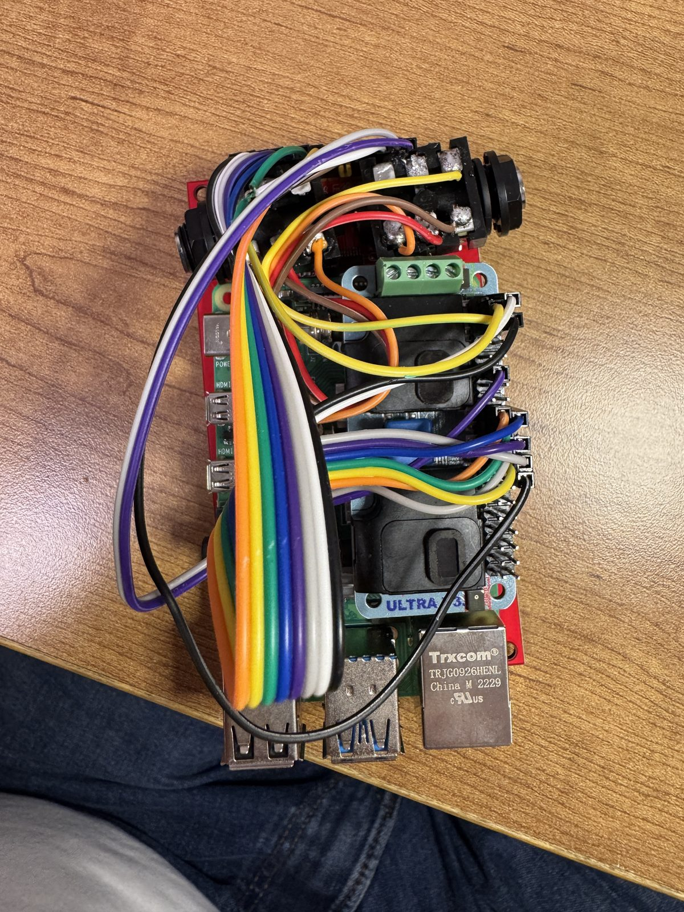
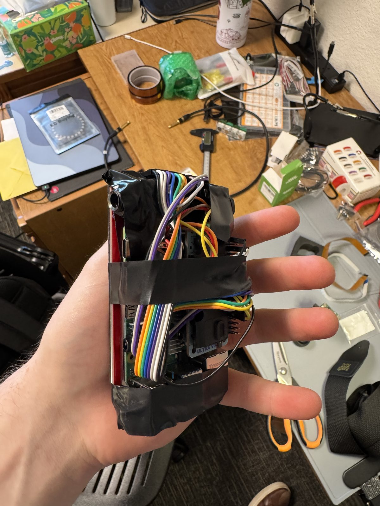
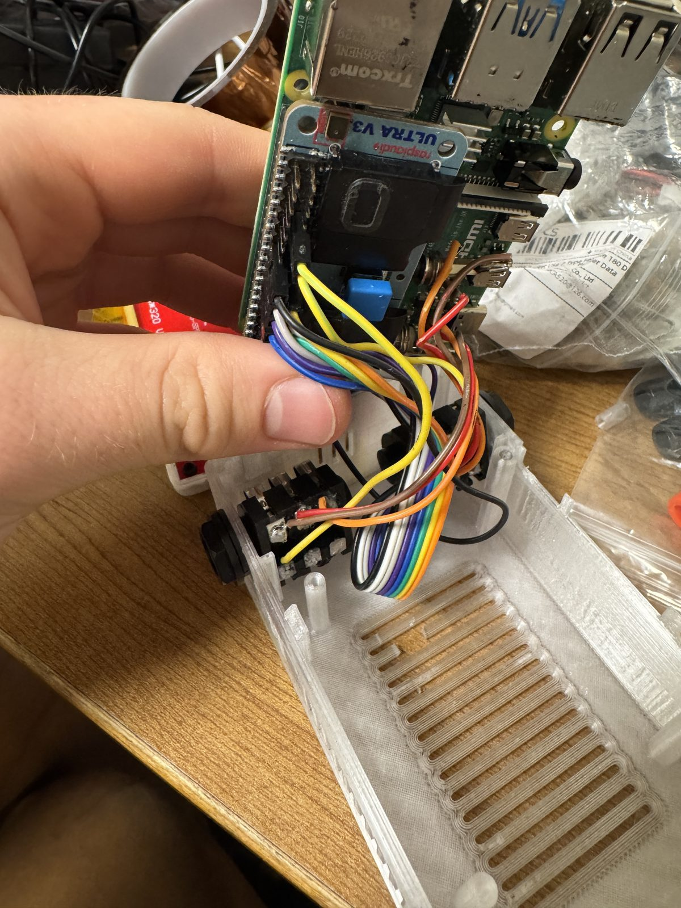

# bassbox

<p align="center">
  
</p>

A bass multi-effects pedal on a Raspberry Pi 4, with a codec HAT for audio in and out, a 4-inch touchscreen and a 3D-printed box. You build a chain of effects on the screen (distortion into delay into wah, say), and it boots straight to play. It has 33 effects, including a neural amp model and a looper, plus a tuner and 11 presets.

I built it in October. The write-up is short because I haven't had time to document it properly yet.

<p>
  
  
  
</p>

It started on October 1 as a single preset in PiPedal (an open-source pedalboard host for the Pi), controlled from a browser on my laptop. That version is in [`history/v1-pipedal/`](history/v1-pipedal/). Then the goal changed to a whole pedal: plug in a bass, build the chain on the touchscreen, no laptop. So I built my own engine and touchscreen app, and by October 6 the whole thing was held together with electrical tape (above). The box came last.

Offline renders through the engine, on a synthetic test riff: [dry](media/offline-render-test-riff-dry.mp3), and [through the Night Drive preset](media/offline-render-test-riff-night-drive.mp3).

As of October 18 a real bass wasn't getting from the input jack to the codec (the wiring was the suspect), so latency and input gain are unmeasured. What's been measured and what hasn't is in [`docs/status.md`](docs/status.md).

## How it works

```
bass -> panel IN (1/4") -> HAT line in -> WM8960 ADC --I2S, 48 kHz--> bassbox-engine (C++, CPU 3, SCHED_FIFO)
          in gain -> up to 8 effect slots -> out gain -> DC blocker + soft limiter -> DAC -> panel OUT (1/4")

bassbox-ui (Python, CPUs 0-2) <--JSON lines over a unix socket--> engine control thread (presets, tuner, jack sense)
```

- **Hardware:** Raspberry Pi 4, RaspiAudio ULTRA++ HAT (WM8960 codec), a 4.0" SPI display (ST7796S, 320 x 480) with XPT2046 resistive touch, two 1/4" jacks, power over USB-C. Wiring is in [`docs/hardware.md`](docs/hardware.md), and the codec setup is in [`docs/audio-path.md`](docs/audio-path.md).
- **Engine** ([`engine/`](engine/)): the audio thread runs on its own CPU core at real-time priority, with 64-frame buffers at 48 kHz ([`docs/realtime.md`](docs/realtime.md)). `bb-render` runs the same code offline on a WAV.
- **UI** ([`ui/`](ui/)): Python and cairo drawing straight to the display.
- **Box** ([`enclosure/`](enclosure/)): generated from code with build123d and printed in PETG.
- **Architecture:** [`docs/architecture.md`](docs/architecture.md).

## What's in here

| Path | What it is |
|---|---|
| [`engine/`](engine/) | The C++ engine, 33 effects, tests and test results |
| [`ui/`](ui/) | The touchscreen app, design notes, mockups and screenshots |
| [`display/`](display/) | Display and touch setup helpers |
| [`presets/`](presets/) | The 11 factory presets |
| [`config/`](config/) | systemd units, the codec mixer profile, the device-tree overlay, display and touch settings |
| [`scripts/`](scripts/) | Setup, push, check, soak and test-signal scripts |
| [`enclosure/`](enclosure/) | The enclosure generator, its tests, STL/STEP/3MF exports, renders and print profiles |
| [`history/v1-pipedal/`](history/v1-pipedal/) | The first version on PiPedal |
| [`docs/`](docs/) | Architecture, audio path, real-time notes, hardware, OS changes, status |
| [`media/`](media/) | Photos and the offline audio renders |

## Building it

- Engine: [`engine/README.md`](engine/README.md) (fetch the three dependencies, then CMake).
- UI: [`ui/README.md`](ui/README.md). It also runs on a laptop against a mock engine.
- Setting up a Pi: [`scripts/README.md`](scripts/README.md).
- The box: [`enclosure/README.md`](enclosure/README.md) (regenerate with build123d, or print the STLs in `enclosure/exports/`).

## Known issues

- The input wiring (above).
- The screen flashes white for about 10 seconds at boot, because its backlight is wired straight to 3.3 V.
- `scripts/setup.sh` doesn't install `python3-cairo`, which the UI needs.

## Credits

- [PiPedal](https://github.com/rerdavies/pipedal) ran the first version.
- [NeuralAmpModelerCore](https://github.com/sdatkinson/NeuralAmpModelerCore), [Eigen](https://eigen.tuxfamily.org) and [nlohmann/json](https://github.com/nlohmann/json) in the engine; versions and licences are in [`engine/third_party/README.md`](engine/third_party/README.md).
- [build123d](https://github.com/gumyr/build123d) for the enclosure.
- The UI fonts are under the SIL Open Font License (see [`ui/fonts/`](ui/fonts/)).

## License

MIT for my code ([`LICENSE`](LICENSE)). The third-party libraries and fonts above keep their own licences.
