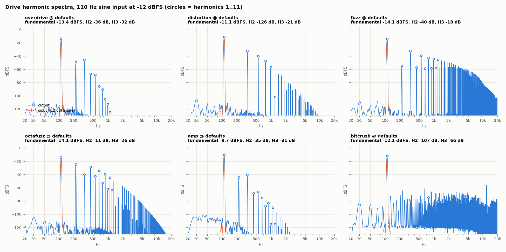
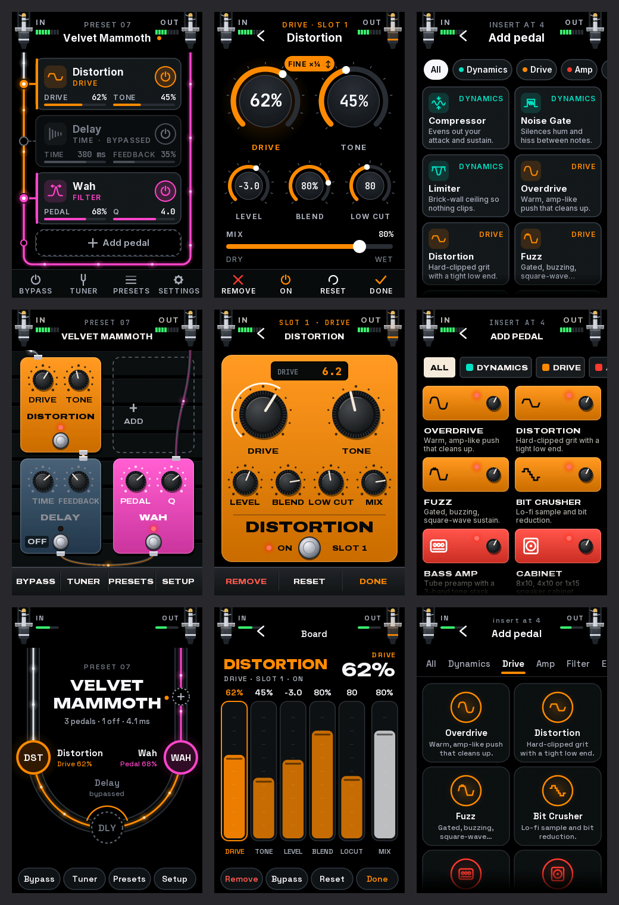
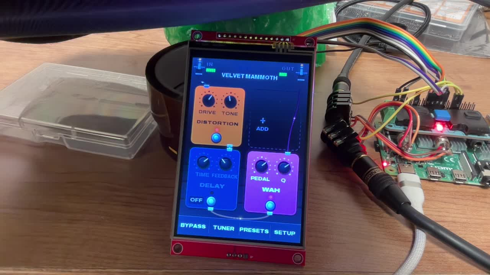
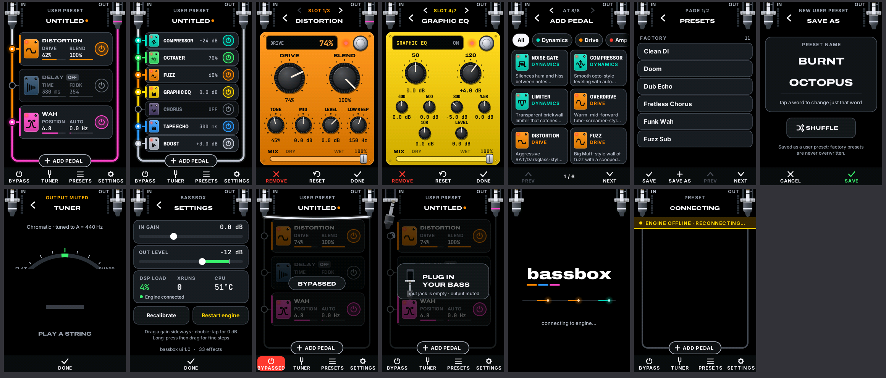
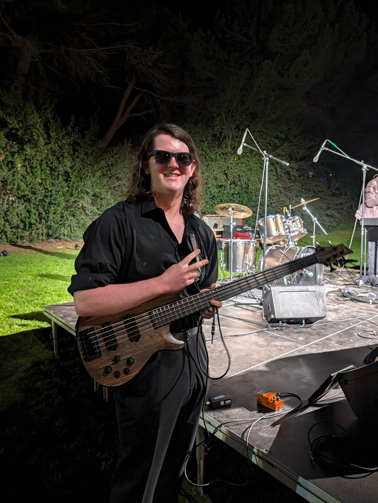
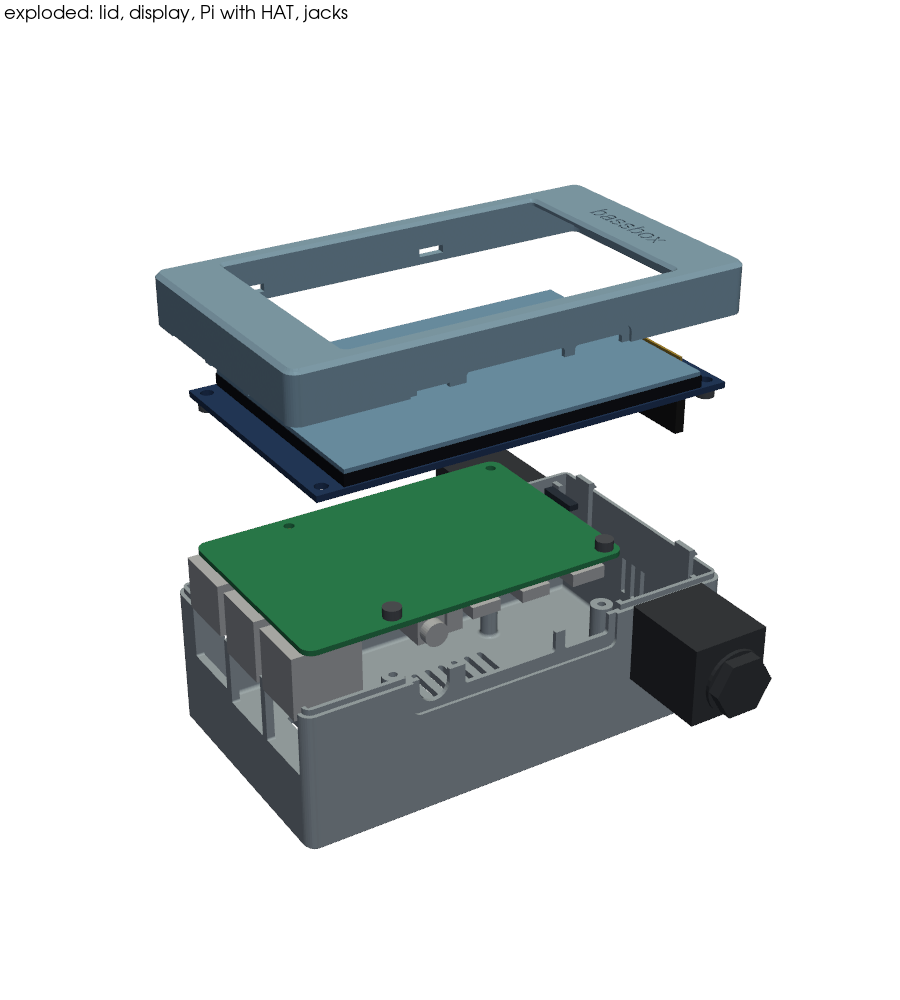
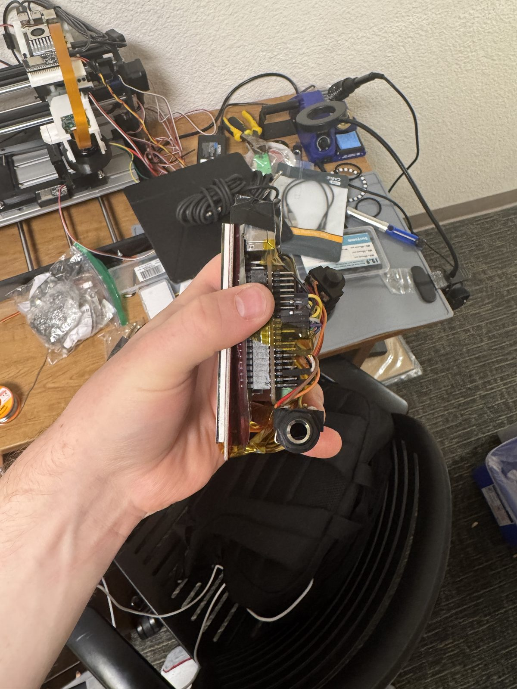

# bassbox

<p align="center">
  
</p>

A bass effects pedal built on a Raspberry Pi 4, with a codec HAT for audio in and out and a 4-inch touchscreen, in a clear printed box. You build a chain of effects on the screen (distortion into delay into wah, say), and it boots straight to play, about 20 seconds from power to sound. There are 33 effects in there, including a neural amp model and a looper, plus a tuner.

It isn't finished. The engine, the effects and the touchscreen all run on the Pi, but the last time I tested it with a real bass (October 18) the signal wasn't making it from the input jack to the codec. That's the next thing to fix. The full list of what's been measured and what hasn't is in [`docs/status.md`](docs/status.md).

## How it went

### October 1: one preset in a browser

The first version was PiPedal (an open-source pedalboard host for the Pi) running a single preset called Bass Drive: a noise gate, then a split between a neural amp model and a clean copy of the signal low-passed near 200 Hz (to keep the low end solid), then a volume. You controlled it from a browser on my laptop. I set it up in an afternoon, before the codec HAT had even arrived, and the preset was live about 36 seconds after boot. That version is in [`history/v1-pipedal/`](history/v1-pipedal/).

### October 5-6: a screen, and starting over

<p>
  
  
</p>

The night of October 5 the touchscreen came up: a 4-inch SPI panel (320 x 480) with resistive touch, wired onto the HAT's pass-through header. At some point the screen got powered with VCC and GND swapped, which killed its 3.3 V regulator, so now it has a jumper bridged and runs straight off the Pi's 3.3 V. The codec wasn't answering at all at first either.

Then the goal changed from one preset in a browser to a whole multi-effects pedal: plug in a bass, build a chain of effects on the touchscreen, no laptop, no login. So I dropped PiPedal and built my own engine and touchscreen app. By the next afternoon the whole thing was held together with electrical tape (above).

Getting clean audio out of the codec took four fixes. The first capture sat at +0.85 of full scale and kept creeping toward the rail on its own. The causes:

1. The input amplifier was in a mode that doesn't work on this board, so it drifted to the rail. The fix was to skip it.
2. The driver's "high-pass filter" switch is backwards, so "on" turned the filter off.
3. The mixer script silently ignored every one-character value, like `0`.
4. The HAT's speaker amplifier powers up whenever audio plays, even muted, and raised the noise floor by about 10 dB. A device-tree overlay now lets it be switched off.

After that the input reads about -93 dBFS with nothing plugged in. The details are in [`docs/audio-path.md`](docs/audio-path.md).

### The engine

<p>
  
</p>

The engine is C++ with the audio thread on its own CPU core (the kernel keeps everything else off core 3), at real-time priority with its memory locked. It runs 64-frame buffers at 48 kHz. With three of them, a heavy six-effect chain, a background CPU load and the touchscreen animating, it did 10 minutes with zero dropouts at 12.9% average load. With two it drops out thousands of times, because the I2S hardware reads about 32 frames ahead and eats the slack ([`docs/realtime.md`](docs/realtime.md)).

All 33 effects go through an offline test harness that sweeps every parameter to its corners and plots what each one does (the plot above is the drive effects on a 110 Hz tone). The neural amp effect runs NAM Core with a NEON patch that halves the cost of its "A2 Full" models on the Pi 4, from 440 to 220 microseconds per block.

What it sounds like, rendered offline through the same engine code on a laptop (the riff is a synthetic test signal, not a real bass): [dry](media/offline-render-test-riff-dry.mp3), and [through the Night Drive preset](media/offline-render-test-riff-night-drive.mp3).

The 11 factory presets: Clean DI, Doom, Dub Echo, Fretless Chorus, Funk Wah, Fuzz Sub, Grit, Modern Grind, Motown, Night Drive and Synth Bass.

### The touchscreen app

<p>
  
  
</p>

There were three design directions, all drawn at the panel's actual size: A ("Signal Line"), B ("Pedalboard") and C ("Orbit"). A and B also got tried on the screen itself (B is above). The final app uses A's board and library with B's pedal faces for editing.



The screens: the board (your chain on a signal line, with level meters), a pedal editor for each effect (knobs you drag, a wah treadle, looper buttons, a picker for neural amp models), the effect library, presets (save-as picks a name for you, so there's no typing), a tuner, settings, and an audio check that sets the input gain for you.

### October 10: the show



I play bass in a prog rock band. That's me on October 10. The orange pedal by my feet is a store-bought one.

### October 18: plugging in a bass

On October 18 I plugged in a bass and an amp for the first time, and nothing came through. Every input setting sat at the noise floor, while the HAT's own microphones could hear the strings acoustically. So capture works, and the suspect is the wiring between the input jack and the HAT. That's the state of it right now.

### October 19-21: the box

<p>
  
  
  
</p>

I wanted a small, sturdy box, so the wiring can't short or come unplugged in a backpack: the screen on top, the Pi's ports on the sides (USB pedals go in the USB-A ports), and sticky feet on the bottom. The enclosure is generated from code (build123d) and checked against models of every part that goes inside it, with numbers from datasheets and my calipers. The Pi sits upside down under the display, and the lid and base split at the Pi's top face and snap together. The snap tabs ended up on the base because the display couldn't get past them on the lid. It's PETG instead of PLA, because the Pi runs warm in a closed box and PLA starts creeping around 55 °C. I had the IN/OUT text taken off the lid and kept "bassbox". The base above is printed in clear PETG.

## How it works

```
bass -> panel IN (1/4") -> HAT line in -> WM8960 ADC --I2S, 48 kHz--> bassbox-engine (C++, CPU 3, SCHED_FIFO)
          in gain -> up to 8 effect slots -> out gain -> DC blocker + soft limiter -> DAC -> panel OUT (1/4")

bassbox-ui (Python, CPUs 0-2) <--JSON lines over a unix socket--> engine control thread (presets, tuner, jack sense)
```

- **Hardware:** Raspberry Pi 4, RaspiAudio ULTRA++ HAT (WM8960 codec), a 4.0" SPI display (ST7796S, 320 x 480) with XPT2046 resistive touch, two 1/4" jacks, power over USB-C. Wiring and the display fix are in [`docs/hardware.md`](docs/hardware.md).
- **Engine** ([`engine/`](engine/)): ALSA full duplex, an audio thread pinned to an isolated core, chain edits without clicks (effects crossfade in and out), a 3-second watchdog that lets systemd restart it, and a YIN tuner on the control thread. `bb-render` runs the same code offline on a WAV, and `bb-selftest` runs 47 checks without any audio hardware.
- **UI** ([`ui/`](ui/)): Python and cairo drawing straight to the display (DRM or framebuffer), redrawing only what changed. It idles at about 0.3% CPU.
- **Boot:** systemd units set the CPU governor, apply the codec mixer profile, then start the engine and the UI. The kernel command line keeps core 3 to itself. The changes to the OS are listed in [`docs/system-changes.md`](docs/system-changes.md).
- **Architecture:** [`docs/architecture.md`](docs/architecture.md).

## What's in here

| Path | What it is |
|---|---|
| [`engine/`](engine/) | The C++ engine, 33 effects, tests and test results |
| [`ui/`](ui/) | The touchscreen app, design notes, mockups and screenshots |
| [`display/`](display/) | Display and touch setup helpers |
| [`presets/`](presets/) | The 11 factory presets |
| [`config/`](config/) | systemd units, the codec mixer profile, the device-tree overlay, display and touch settings |
| [`scripts/`](scripts/) | Setup, push, check, soak and test-signal scripts |
| [`enclosure/`](enclosure/) | The enclosure generator, its tests, STL/STEP/3MF exports, renders and print profiles |
| [`history/v1-pipedal/`](history/v1-pipedal/) | The first version on PiPedal |
| [`docs/`](docs/) | Architecture, audio path, real-time measurements, hardware, OS changes, status |
| [`media/`](media/) | Photos and the offline audio renders |

## Building it

- Engine: [`engine/README.md`](engine/README.md) (fetch the three dependencies, then CMake).
- UI: [`ui/README.md`](ui/README.md). It also runs on a laptop against a mock engine.
- Setting up a Pi: [`scripts/README.md`](scripts/README.md).
- The box: [`enclosure/README.md`](enclosure/README.md) (regenerate with build123d, or print the STLs in `enclosure/exports/`).

## Known issues

- The bass isn't reaching the codec yet (above), so round-trip latency and input gain are unmeasured. The roughly 4 ms in the docs is the buffer math, not a measurement.
- The screen flashes white for about 10 seconds at boot, because its backlight is wired straight to 3.3 V. Fixing that needs a transistor on a free GPIO.
- Passive basses sound a little darker without a buffer in front, because of the codec input's impedance.
- `scripts/setup.sh` doesn't install `python3-cairo`, which the UI needs.

## Credits

- [PiPedal](https://github.com/rerdavies/pipedal) ran the first version.
- [NeuralAmpModelerCore](https://github.com/sdatkinson/NeuralAmpModelerCore), [Eigen](https://eigen.tuxfamily.org) and [nlohmann/json](https://github.com/nlohmann/json) in the engine; versions and licences are in [`engine/third_party/README.md`](engine/third_party/README.md).
- [build123d](https://github.com/gumyr/build123d) for the enclosure.
- The UI fonts are under the SIL Open Font License (see [`ui/fonts/`](ui/fonts/)).
